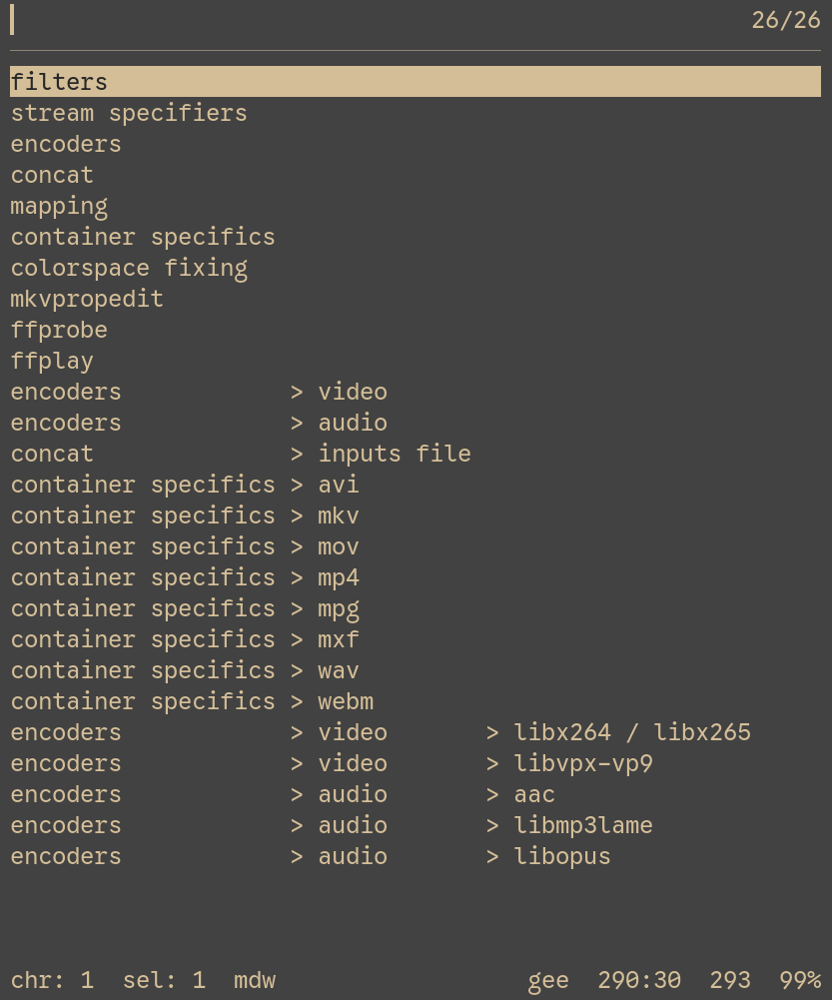

Gee is a markup language designed to never leave your editor.

Markdown — what gee is based on but not inspired by (or the other way around? whichever is the greater insult to markdown) — is often times intended to *go* somewhere; to be rendered into something html-like.
A github comment, a discord message, a blog post, etc.

But prior to the rendering step, you see markdown in your *editor*.
You don't *actually* have anything rendered in that context¹, but things getting highlighted is still pretty useful visually.

¹ The only exceptions are italic, bold, and strikethrough. All other things are raw, but just *colored* differently; which is hard to call a *rendered* markup.
For instance, notice how a heading of level 1 isn't giant in your editor (for obvious reasons)

However ☝️ there is a limited amount of what is *also* useful in the editor — a lot of markdown's structures are only relevant *because* you intend to render it somewhere. \
But if you were writing that markdown for it to *stay* in your editor, the highlighting / special handling of many structures is only vaguely neat, if even, yet you pay a complexity cost to get them — too many things are too special in too many contexts, and you find yourself overescaping and “dealing with” markdown instead of enjoying it.

There's no point in the very hard to write tables, if I can just do ↓ instead
```
a — e — j
b — f — k
c — g — l
d — h — m
```
Or, like, anything else. Whatever I find the most convenient, which is certainly not markdown's tables.

Unordered lists? You know what else is an unordered list? *Lines*. \
Something that I like to do in my notes is ↓
```
I own the lines below
   I am owned by being indented
   me too!
```
This is much easier to look at! Since I'm not rendering this text anyway, each line can remain a whole line, where when markdown renders, the lines I see separated in my editor get conjoined into one.

Did you know that in markdown, at any spot there can be arbitrary html?
You don't need this in markup you don't intend to render for obvious reasons.
You don't need the latex support either.

Markdown tries to be gentle to everyone in that you can `*italic*` or `_italic_`, `**bold**` or `__bold__`; letting you choose your exact preference.
Well I picked that my preference is `*` for everything, but I pay the cost of `_` still being available by paths sometimes becoming italic... awesome /s \
Here's an example: /path/_to/italic_/path

Then also, `_` sounded nice until I actually tried to use it — since it's a word character, ctrl+backspacing deletes it along with the word I intended to delete, forcing me to retype the italic / bold opener. Something that doesn't happen with `*`.

Gee's geeoal is to be the perfect language for my noting system.
But more broadly, to be a better markdown inside your editor, and not try to be fill markdown's shoes in other places (things that you intend to render into something). And also to be fast. \
With that, it gets a simpler grammar that bites you in the ass less often or at least more predictably, has some nifty extra features, and treesitter-based movement is more polished because the dev of the treesitter (me!!) actually actively uses it.

# features
## italic, bold
```
*italic*
**bold**
***italibold***
```
`_`, as I alluded to, is no longer used — it's raw.
You decide among italic, bold, and italic+bold by the amount of `*` you use around the thing.

Note that italibold is its own thing.
In markdown, it's expressed as a bold that is held inside of an italic, and a little jarringly the outerest `*`s are only italic — not also bold.
By making it a single element, *all* of the `*`s can be consistently bold *and* italic. \
Then also when you try to treesitter select parent, you only need to take one step to select `***bolditalic***`, not two to first select the bold and then the italic.

Using the same character for multiple different markups can quickly create ambiguity, so there's a rule all¹ surrounder markups share: there must be NO whitespace after the opener and NO whitespace before the closer.
So `word *italic* word` is a valid italic but `word *italic * word` is not — the latter gets parsed as raw.
You *can* however markup a *part* of a word like `mylong*word*`.

¹ Except inline code and references

Whenever you enter a markup, you must decide on a single combination at once: you can't italic some text and then also bold part of it. \
i.e. you can `***do something like this***` but not `*something **like** this*`.

Another disambiguator is that gee won't guess what you mean, if your `*` pairs are uneven: it'll treat both as raw.
`*this is italic*`, but `**this is entirely raw*`. \
Thanks to this you don't get the italic → bold flicker as you're typing in the closers ↓

https://github.com/user-attachments/assets/10370d16-0bde-4d3a-91ed-dfceb76a79a1

The last one-two punch is that gee's paragraphs are parsed linewise, so you'll never experience that situation where you now have a long ass multiline italic just because there was something with a `*` on the *previous* line.
If your editor is quarter decent, you should not feel forced to hard split your lines, *especially* not feel so forced that you would put the contents of a markup across multiple lines.

Coming back to the treesitter select parent thing: I think *all* types of surrounders in gee work in such a way where you can tsp (please intuit what this abbreviation could *possibly* mean) to first select the *contents*, and then the contents + the surrounder.
This also lets you treesitter select *child* to select the contents of a surrounder that's usually very annoying to get inside of (`**` / `***`).
Third: you can treesitter sibling move among all markups within a paragraph.

https://github.com/user-attachments/assets/affc6984-0a39-4ae9-8bed-8112ddb2adf3

## strikethrough
```
~~strikethrough~~
```
You can mix it with italic / bold / italibold to get italistrike / bike / italibike ¹, BUT ☝️ the strikethrough must be on the outer. \
`~~*italic strikethrough*~~` but NOT `*~~italic strikethrough~~*`. \
Why? Vague design decision 😌 \
The latter looks really wrong to me and I don't want to pay the performance price to allow it.

¹ Okay I'm playing around: *those* aren't separate elements. The mixes *are* an italic inside of a strikethrough, instead of a singular italic+strikethrough node — because the two use different operators from each other.

## inline code
```
`inline code`
```
Unlike in markdown, you can inject syntax highlighting into *inline* code too ↓
```
`puts "hi"`;crystal
```
will get `puts "hi"` highlighted as crystal. \
You can use either `;` or `:` depending on which feels righter to you, and the reason it's required there is that sentences like ↓ I sometimes produce.
```
you can blammo some `⇉`s in there
```
With no separator, `s` there would try to become a language injection, which might happen to match an actual language and BOOM you now unintentionally pay the startup time of that language's treesitter when you open the note that you want to be fast to open.

Gee doesn't have escaping (at least not intentionally), so whenever you need to place some symbol *literally*, but it turns into its special meaning, you are meant to wrap it in an inline code¹.
Because of this, inline code is more “strong” than it would need to be otherwise: you **cannot** place a lone backtick without turning something special.
If there is an unclosed backtick, the rest of the line becomes code.

You can totally use this intentionally if you want: treesitter movement is still correct, so you can select the insides of that code just as well, jump among markup siblings, etc.

And secondly, inline code cannot be contained within other markup; if you try to, inline code “wins”:
```
*maybe `italic` code*
```
will be two stray (i.e. non-special) `*`s, with a normal `italic` code.

¹ I feel urged to say “inline codeblock” but that's an oxymoron, lol.

## references
```
«reference»
```
It's common that I want to express “it's like this other thing you also have noted down somewhere”.
But rarely do I want to provide both a name and also some sort of link / path.
Usually *just* the name would be enough, if only I could signify it's special somehow.

References fulfill that job. *Mechanically* they are basically just recolored inline code: they treat markup inside of them as raw instead, and cannot be contained within markup just like inline code can't.
But *semantically* they are different: they are meant to *refer* to something, while inline code doesn't necessarily do that. Or rather, it usually doesn't.

Here I have a note where I'm explaining the `rindex` method for `String` in crystal:
```
# rindex
«index» from the end
```
I already explained all the semantics and special cases in `index`, reexplaining them here is a waste. So I just cleanly *refer* to it, saying “it's like this other thing that is the ‘source’ of truth, but here's the difference”

Another thing that references allow you to do thanks to their mechanics, is blammo an arbitrary amount of backticks rawly anywhere. \
Normally three backticks inside of a line will be an inline code with no content + another one that trails off to the rest of the line. You can't exactly work around this normally, but you can wrap them in `«»` and boom! now you can easily *mean* three backticks literally, and nothing trails off.

For consistency with inline code, an unclosed `«` will make the rest of the line to be a reference. Again, handled properly in terms of treesitter movement and selection.

## paragraph
Is a sequence of lines, which ends either at a blank line or another block node like a codeblock or a heading.
Unless you're currently on some markup, a paragraph is the lowest “level” so to speak, when it comes to treesitter parent selection. \
So you can treesitter sibling move by gee paragraphs *semantically*, instead of necessarily by blank like separated paragraphs your editor probably provides.
Very useful if you like to squish things together.

## codeblock
This will be a little hard to show in the context of markdown, lol. I can't exactly put a codeblock in a codeblock.
But thankfully the usual syntax is 1:1 like it is in markdown.

However ☝️ you can also choose to use 4, instead of 3 backticks as delimiters.
Thanks to this you can express a codeblock *inside* of a codeblock, if you are for example making a gee note on markdown, or even on gee.

For me it has already come in handy in my note on rust doccomment syntax:

![./img/rust-doc-example.webp]

The first codeblock delimiter that opens is also the one that needs to resolve first.
Meaning that instead of the 4 backtick variant necessarily always being stronger than the 3 backtick variant, one can contain the other easily:

![./img/contains-the-other-example.webp.webp]

## heading
Starts with an amount of `#`s to specify the level, and has 6 levels — just like in markdown.

There's a small improvement in treesitter selecting: before you treesitter select parent the *entire* heading, including its header, you will first be able to select the *contents* of the heading. And only the next step selects the header *too*.

Notably ☝️, *no* markup is recognized in the heading title, because I don't need it outside of a rendering context.

In my [helix fork](https://github.com/Axlefublr/helix), I added a picker that shows me headings in a hierarchical fashion, for me to be able to navigate to any of them easily, even and *especially* if I forget the exact name of a leaf heading.



It's a core piece of why I love my noting system so much 🥰 and helps explain why I would never want markup inside of a heading title — more characters due to markup syntax, is more length for the worst case line in the picker, leading me to not see everything I need to see in the picker.

## untitled heading
You can make leveled *untitled* headings, too. But instead of `#`, you use `━`. This is the horizontal thick border character, not a minus. You heard me. \
Also up to 6 levels (inclusive), and is also included in the picker I mentioned above.

## bracket and triangle
```
[bracket]
<triangle>
```
I like to read a lot of manpages, and from there I stole the syntax of using `<>` to mean a required argument, and `[]` to mean an optional argument — I use that semantically all over my notes.

Because of something like `[as <Namespace>]`, where a placeholder namespace is *required*, but only inside of an overall optional argument, a bracket can contain a triangle, and a triangle can contain a bracket.
But a bracket cannot nest another bracket and a triangle cannot test another triangle — only the inner one will be recognized.

Either of the two may be followed with a *type specification* (you heard me):
```
[argument-name]:int
<argument-name>:int
```
Where `int` will be highlighted as a type, and that type specification is a treesitter sibling to the briangle.
The entire `<argument-name>:int` will be the sibling to other markups in the paragraph.

The type can be complex: it ends once it encounters whitespace or the end of the line.
```
<hash>:Hash<string,any>|NamedTuple
```
Instead of that entire complex type being colored as a type, only the type “words” are. So `<`, `,`, `>`, `|` will stay white. \
I don't implement any kind of fancy nesting: `Hash`, `<`, `string`, `,`, `any`, `>|`, `NamedTuple` are just siblings to each other, rather than something like `string,any` being a child of the `<>` which is a child of the `Hash`.
So you can use whatever syntax is most pleasant to you, as long as you're okay with it ending on a space.

If a `?` follows a “type word”, it's colored differently to make it clear that type is nullable
```
<arg>:string?
```

I lied. Aside from a space, the type may also end on a `≔`. Yes, that character literally. \
It's meant for you to be able to specify what the *default value* of some parameter is.
```
[should-do-behavior]:bool≔true
```
Here, `bool≔true` becomes the sibling to `[should-do-behavior]`.
And inside of the former, `bool`, `≔`, `true` are siblings to each other.

The `true` there is completely raw and doesn't understand any markup. Ends at a whitespace.

Although with such a simple type as `bool`, it's a little redundant to specify it. Especially considering that the name of the parameter is already clearly a boolean. The type specification is optional, you can immediately specify the default value:
```
[should-do-behavior]≔true
```
In my queries (that I'll talk about later) I color `≔` there so that it sticks out more clearly.

## return expression
```
⇉Vec<String>
```
I already explained the type node above (the thing between `:` and `≔` in `:bool≔true`), and it can be used in another situation: right after a `⇉`.
We already can specify the types of all arguments for a program / function we're noting down, and the last thing to express is the type that the thing *returns*.
The `⇉` is colored the same as the `≔`, to stick out.

I didn't actually show you the full `rindex` example the last time, because it would terrify you. Now that I've explained all you need to know to understand it, it probably still will, but here you go:
```
# rindex
<search>:char [offset]≔<size>-1 ⇉Int32?
<search>:string [offset]≔<size>-<search>.size ⇉Int32?
<search>:Regex <offset>≔<size> <*> [options] ⇉Int32?
«index» from the end
```
Note that those `<size>` and `<search>` are *not* highlighted as triangles; they are raw. I just “say” them because I know what I mean, but they don't hold special meaning in *gee the language*.

## semantic operator
Last thing. These characters: `↔`, `↕`, `⥯`, `⇌`, `⇇`, `⇊`, `⇈`, `⇉` are highlighted specially when outside of markup. \
As the name implies, I use these characters with specific semantics that I want to stand out on a glance.

`⥯`, `⇌` is the “syntax sugar operator” — when two different things are different syntax to express the same thing. \
`↔`, `↕` is what I use to express the same concept to another human, rather than in my notes that only I see; they're a little uglier in monospace but easier to guess the meaning of. \
`⇇` — “depends on” \
`⇈` — “I'm omitting some details here that you can guess from the context of the rest of the document, usually above” \
`⇊`, `⇉` — “transforms into” or “returns”. Note that the return expression only kicks in if there is no space after the `⇉`, so if I put a space after the `⇉`, only the `⇉` is highlighted, and the next word is untouched.

# install
I'll only explain the helix steps because it's the only editor I use, but of course gee can be used in other editors, provided someone writes the queries.

Put this into your languages.toml:
```toml
[[language]]
name = "gee"
scope = "source.gee"
indent = { tab-width = 3, unit = "   " }
file-types = [ "gee" ]

[[grammar]]
name = "gee"
source = { git = "https://github.com/Axlefublr/tree-sitter-gee", rev = "<hash>" }
```
, replacing `<hash>` with the (full) commit hash of the latest commit of this repo. Or your favorite commit of before I remove your favorite feature /hj

Then run `hx -g fetch && hx -g build`.

Next, grab the queries from [here](./queries/helix/) and put them into ~/.config/helix/runtime/queries/gee/ \
For a pleasant custom queries setup, you might be interested in the fuller explanation in my [custom queries repo](https://github.com/Axlefublr/qiri).

A bunch of stuff in gee is concepts that don't really fit the bill of other existing highlight groups, or when they do, I happen to still want a different color :p, so I add a bunch of new highlighting groups, that you should add into your theme:

|group|used by|
|-----|-------|
|`@operator.markup`|semantic operators, `?` after a type word, `≔` after a briangle|
|`@markup.italicbold`|italibold|
|`@markup.loose`|contents of brackets|
|`@markup.strict`|contents of triangles|
|`@markup.reference`|contents of references|

Here's what I specify them to:
```toml
'markup.italicbold' = { modifiers = [ 'italic', 'bold' ] }
'markup.loose' = 'mint'
'markup.reference' = 'blush'
'markup.strict' = 'green'
'operator.markup' = 'blush'
```
Here's my entire theme if you need more context: <https://github.com/Axlefublr/dotfiles/blob/main/helix/themes/gruvbox_material.toml> \
And here's a backup link in case I move or rename the file: <https://github.com/Axlefublr/dotfiles/blob/b031be47f9f7a4cdb01e31c7f362f9324dd3cf99/helix/themes/gruvbox_material.toml>

# lastly
Gee is a very selfish language, as you might have already noticed. \
Quite a few special symbols are unicode characters for *all* of which maybe only *I* have hotkeys for, maybe in the entire world?
I make the implementation simpler by explicitly not handling cases that I simply will never put myself in.
Features I don't use I simply do not implement.

This is how gee is, and will be: the perfect language for my noting system, but maybe / probably not yours. If you find some parts ridiculous — yep, they are, and they will stay ridiculous unless I just so happen to find something *I* like more. \
With that in mind, I greatly encourage you to fork gee, making your own variant that you enjoy more :3 \
Learning how to make a treesitter parser has been an amazingly fun journey, I heavily recommend it!
